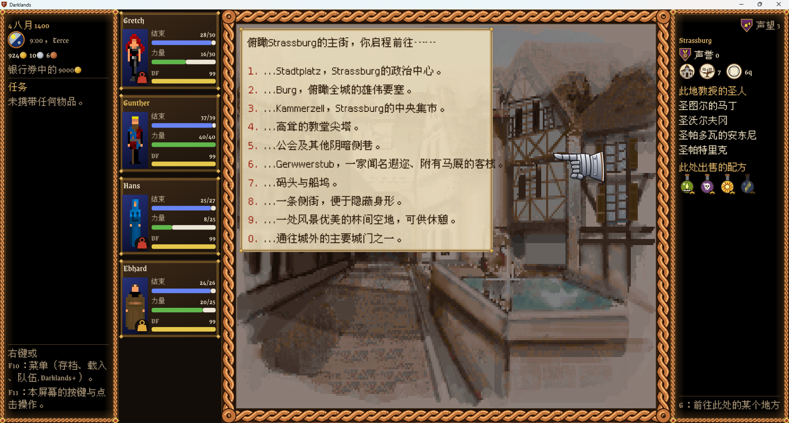
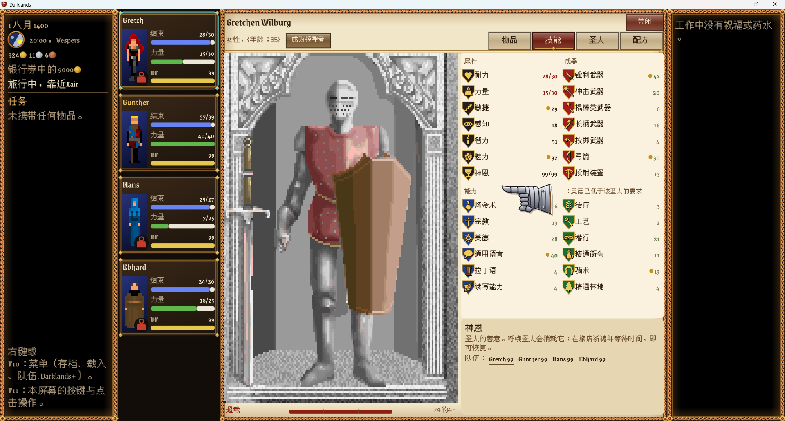
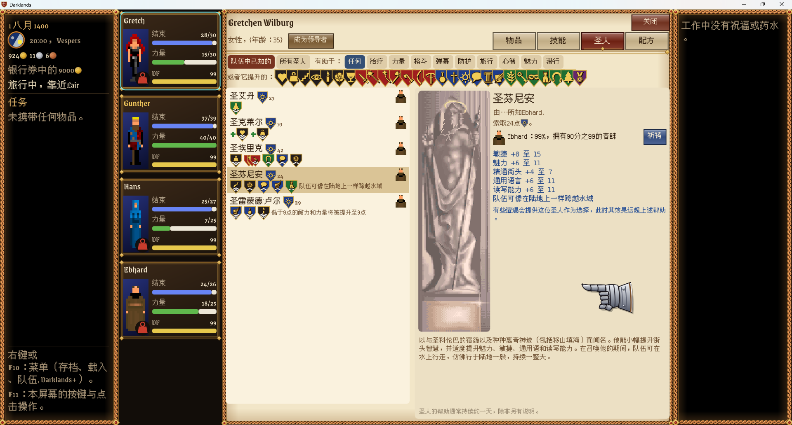
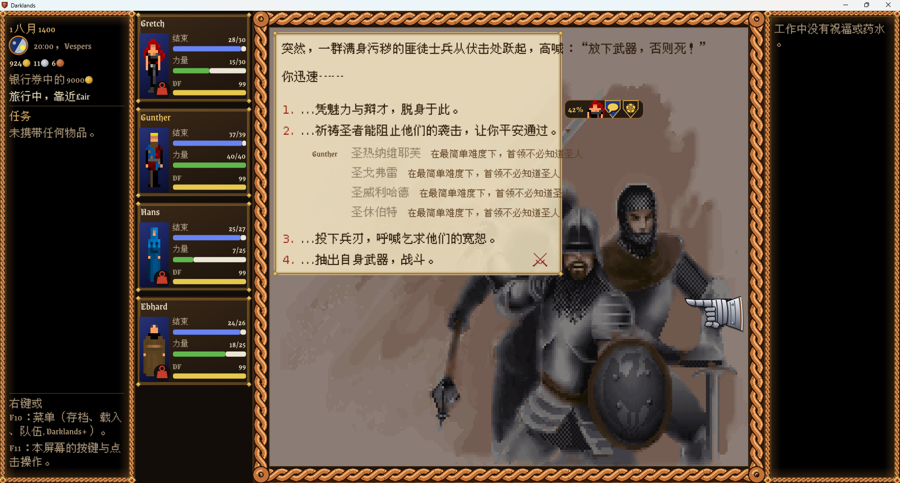
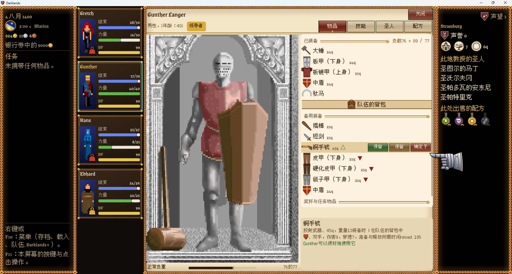

# Darklands+ 简体中文汉化

[Darklands+](https://github.com/bouchacha/Darklands-plus) 的简体中文分支：把 1992 年的《Darklands》——原版 16 位 DOS 程序——整体汉化到可玩程度，包括叙事卡片、移植层 UI、圣人传记、装备名与全部游戏数据表。

上游的英文 README 见 [README.md](README.md)。


*城市主街卡片：标题与九个去向选项全部中文，专有地名按原样保留*

---

## 一、汉化的难点

Darklands+ 不是重写，而是把 `DARKLAND.EXE` 静态重编译，外面套一层现代移植层（SDL2 + ImGui）。这意味着**文本管线仍然是 1992 年的原始代码**，而原始代码对字符的假设是单字节 CP437。

具体三个硬约束：

1. **画字入口 `gfx_text`（`047c:055a`）是原始 16 位汇编**，它把任何 `≥ 0x80` 的字节当成颜色码。把 UTF-8 中文直接塞进卡片字节流，游戏不会报错，只会把它当调色板指令吃掉——文字根本不会出现。
2. **游戏自己的换行逻辑 `draw_text_wrapped`** 用 `text_pixel_width()` 按 ASCII 字宽计算断行。中文一个字占两倍宽度，注入后断行全错。
3. **移植层自身还有 3000 多条英文串**，没有 i18n 框架，全是散落在源码里的字面量。

所以不能"换个编码"了事，只能分三条通道分别处理。

---

## 二、三条文本通道

| 通道 | 文本来源 | 处理方式 | 规模 |
|---|---|---|---|
| ① 叙事卡片 | `MSGFILES`（CAT 档案） | mod 数据层注入，覆盖原始卡片文件 | 419 个卡片文件 / 3756 张卡 / 已译 3636 张 |
| ② 移植层 UI | `port/` 下的 C/C++ 字面量 | 源码级替换，译表留档 | 111 个源文件 / 译表 4292 条 |
| ③ 定长数据表 | `DARKLAND.SNT`、`DARKLAND.LST` | 运行时查表覆盖 | 圣人传记 136 条、物品名 164 条、圣人效果 136 条、配方 66 条 |

### ① 叙事卡片：走 mod 数据层

卡片的真实文本不在源码里，而在 `MSGFILES` 这个 CAT 档案中（419 个 `$*.MSG` 卡片文件）。Darklands+ 自带 mod 系统（`port/mods/datamods.c`），可以重定向 DOS 的文件读取，因此最省事也最干净的路径是**不改游戏代码，只替换卡片数据**。

`mods/chinese/` 就是这样一个 datamod：

- `mod.txt` — mod 声明
- `MSGFILES/` — 419 个已译卡片文件
- `ui_zh.tsv` — 译表存档（4292 条，供后续维护/复用）
- `untranslated.txt` — 明确跳过的条目（目前仅 1 条纯符号卡片）

译文来源优先复用 [darklands-restoration](https://github.com/Arkana-Mechanika-Studios/darklands-restoration) 中文分支的 run 表（7731 条），保证两套汉化的术语一致；缺失部分再补译。

启用方式是在游戏目录的 `darklands_port.ini` 里加一行：

```ini
datamod.chinese = 1
```

### ② 移植层 UI：源码级替换

`port/` 下 3000 多条英文串按 `English => 中文` 的译表批量改写为字面量，涉及 111 个文件、3861 行。这部分是纯文本替换，但**有一类代码绝对不能碰**：

```cpp
static const std::regex re("(.+?) \\((\\d+)\\)");   // 模式串不是给人看的
```

批量替换曾把这里的 ASCII 括号换成全角 `（）`，结果正则构造即抛 `std::regex_error`，点开圣人页必闪退。现在的原则是：正则模式、内部比较键、存档字段名一律列入跳过名单。

### ③ 定长数据表：运行时查表

圣人的生平传记在 `DARKLAND.SNT` 里——1 字节数量 + 每条 360 字节的定长英文，译表管不到。物品名同理，在 `DARKLAND.LST` 的 46 字节记录里。

这类文本在 `port/ui/gamedata.cpp` 用查表覆盖：

- `SAINT_TEXT_ZH[136]` — 圣人传记
- `ITEM_FULL` / `SAINT_FULL` / `FORMULA_PARTS` — 物品、圣徒武器、炼金配方名

键用原文英文，所以不依赖加载顺序，也不会因存档不同而错位。

---

## 三、渲染层：怎么把中文画出来

既然原生 `gfx_text` 画不了中文，就绕开它：

```
原始字形 ──► mods/hdtext.c 识别并擦除 ──► ImGui + TrueType 重画
```

`port/mods/hdtext.c` 会先在屏幕上找到游戏自己画的文本 run，确认字形，擦掉，然后用 ImGui 的 TTF 渲染器按选定字体重画。`port/ui/overlay_text.cpp` 在此之上还提供一条通用通道：mod 目录里的 `text.txt`，格式是 `English => 中文`，对经过 overlay 的整行文本生效。

这也是为什么卡片文本能保留游戏原本的排版位置，却显示成中文——位置是原版算的，字是移植层画的。

---

## 四、字体

| 项 | 值 |
|---|---|
| 字体 | 文泉驿点阵宋体 12px（WenQuanYi Bitmap Song） |
| 子集字形 | 3998 个（其中汉字 3368） |
| 文件 | `port/third_party/fonts/wqy-12px-cjk.ttf`（约 700 KB） |
| 许可 | GPL v2 + 字体嵌入例外 |

选点阵字体是为了和游戏本身的像素风格一致——12px 点阵在原生分辨率下硬边清晰，不会像矢量字体缩放那样发糊。

子集是**按实际用字生成**的：`tools/zh/make_font_subset.py` 扫描全部中文字料（卡片、译表、数据表），只保留真正出现的字，再加上渲染器必需的范围。这样 700 KB 就能覆盖 3368 个汉字，而不是把 2 万多字的完整字库塞进 exe。`tools/zh/glyph_set.mjs` 则用来估算卡片用字的图集开销。

```sh
python tools/zh/make_font_subset.py --src "WenQuanYi Bitmap Song 12px.ttf"
```

脚本末尾会自检并打印 `missing Han=0`，非 0 即以非零码退出——这是防止漏字的闸门。

两处必须注意的细节：

1. **ImGui 缺字要能回退**。`port/third_party/imgui/imgui_draw.cpp` 的 `ImFont::RenderText` 已改造：遇到当前字体没有的字形，自动切到 `ui_font_cjk` 重画。否则一个漏字就渲染成 `?`。
2. **字形范围要含标点区**。`port/ui/ui.cpp` 的 `ranges_cjk` 必须包含 `0x2000–0x206f`，否则 `——`、`“”`、`…` 这些中文标点即便字库里有，也不会被光栅化进图集，显示出来同样是 `?`。

---

## 五、成果

| 项目 | 状态 |
|---|---|
| 叙事卡片 | 3636 / 3756 张（96.8%） |
| 移植层 UI | 111 个源文件、3861 行 |
| 圣人传记 | 136 / 136 |
| 物品 / 圣徒 / 配方名 | 164 / 136 / 66 |
| 字库覆盖 | 汉字 3368，缺字 0 |
| 遗留英文 | 仅少数硬编码于原版汇编层的字符串 |

### 技能页


*属性、武器、能力、神恩四栏全部中文，技能名与游戏内图标一一对应*

### 圣人页


*这一页曾因正则被误译而必然闪退；现在可正常展开，效果条目（敏捷 +8 至 15 等）与传记均为中文*

### 遭遇战卡片


*选项文本与底部圣人提示均为中文*

### 装备与负重


*装备名、部位标注（上身/下身）、负重提示「负载 76 » 89 / 77」与档位「正常负重」均为中文*

---

## 六、构建

需要 MinGW-w64 工具链、GNU make、python3，以及放在 `build/sdl2-win64` 的 SDL2 开发包。

```sh
make -C port TARGET=win64 -j8 SDLDIR=/path/to/sdl2
```

产物：`build/port_win64/darklands.exe`。

运行前把 `mods/chinese/` 放到 exe 同级的 `mods/` 目录下（或游戏目录的 `mods/` 下），并在 `darklands_port.ini` 里启用 `datamod.chinese = 1`。

---

## 七、已知限制

- **少数硬编码字符串**位于原版汇编层（如 `gfx_text` 附近的提示语），不经译表，无法通过数据层汉化。
- **专有地名保留原文**（Stadtplatz、Goldener Engel 等）。它们同时用于地图与事件匹配，翻译会导致逻辑错位；且原文本身就是德语，保留更贴合历史氛围。
- **`DARKLAND.SNT` 传记为定长 360 字节**，中文 UTF-8 更长时由渲染层处理，不写回原文件，因此不影响存档兼容性。
- MT-32 音乐需要自备 ROM，与本汉化无关。

---

## 八、许可与致谢

- 本仓库**不含任何游戏原始资产**，运行时读取你自己的正版安装。
- Darklands+ 移植层：MIT（见上游 [README.md](README.md)）。
- 文泉驿点阵宋体：GPL v2 + 字体嵌入例外（见 `port/third_party/fonts/LICENSE-WQY.txt`）。
- 译文部分复用 [darklands-restoration](https://github.com/Arkana-Mechanika-Studios/darklands-restoration) 中文分支的译表，术语保持一致。
- 《Darklands》版权归 MicroProse / 现权利人所有。
